# Documentación Integral del Código y Arquitectura de draw.io (diagrams.net)

Este documento detalla exhaustivamente cómo funciona el proyecto **draw.io** a nivel de código fuente, cómo se relacionan los diferentes módulos, su ciclo de vida y cómo interactúan las clases y funciones entre sí.

---

## 1. Arquitectura General del Sistema

El proyecto draw.io está organizado en una arquitectura de **cuatro capas concéntricas**:

```
+--------------------------------------------------------------------------+
|  Capa 4: Diagramly (src/main/webapp/js/diagramly/)                       |
|  - App.js, EditorUi.js (ext), DrawioFile, Sync, Cloud Clients, VSDX      |
+--------------------------------------------------------------------------+
|  Capa 3: GraphEditor (src/main/webapp/js/grapheditor/)                    |
|  - EditorUi.js (base), Graph.js, Sidebar.js, Format.js, Menus.js, Actions |
+--------------------------------------------------------------------------+
|  Capa 2: mxGraph Core Library (src/main/webapp/mxgraph/src/)             |
|  - Model (mxCell, mxGraphModel), View (mxGraph, mxGraphView), Util, IO   |
+--------------------------------------------------------------------------+
|  Capa 1: Backend Java / Servlets (src/main/java/com/mxgraph/online/)     |
|  - OAuth proxies, Convert, Export Proxy, Logging, Integraciones          |
+--------------------------------------------------------------------------+
```

### Diagrama Arquitectónico Detallado:
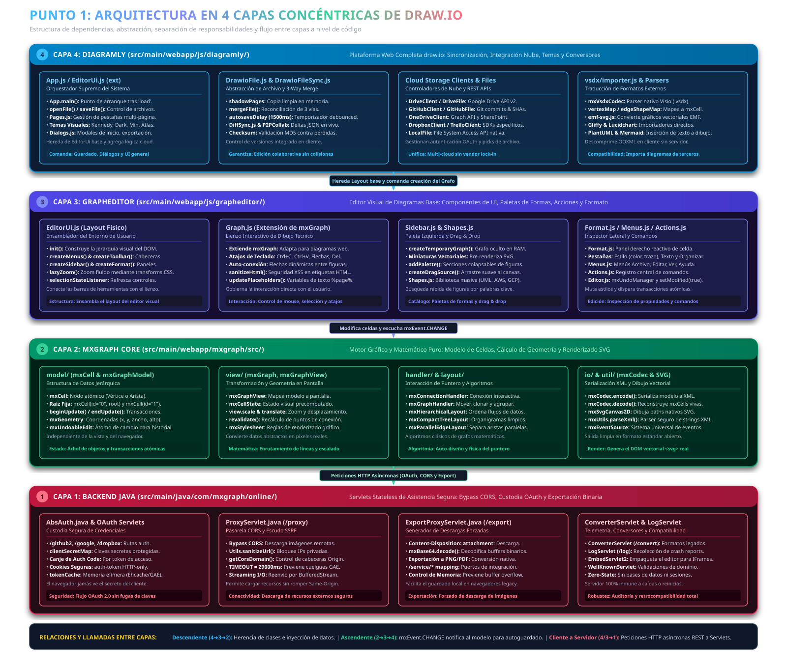

---

## 2. Flujo de Inicialización y Arranque (Bootstrapping)

El siguiente diagrama ilustra cómo arranca la aplicación desde que el navegador carga `index.html` hasta que el usuario interactúa con el canvas del diagrama.

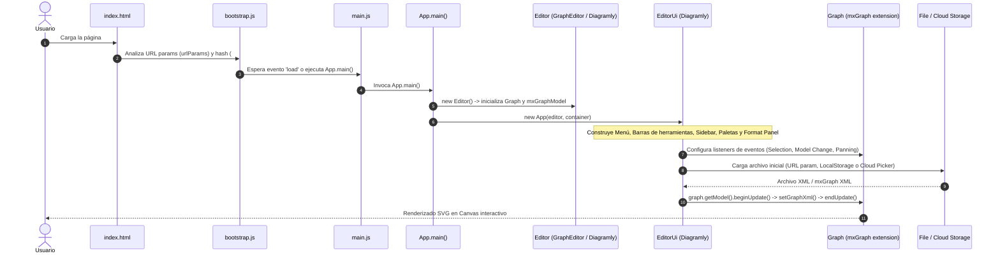

### Explicación del ciclo de arranque:
1. **`index.html`**: Estructura básica DOM con el contenedor principal `#geInfo` y hoja de estilos `grapheditor.css`.
2. **`bootstrap.js`**:
   - Lee `window.location.search` y extrae los `urlParams` (`dev`, `test`, `lightbox`, `sync`, etc.).
   - Soporta deserialización de parámetros codificados en el hash `#P{...}`.
   - Detecta si se ejecuta bajo Electron (`mxIsElectron`).
3. **`main.js`**: Espera la señal de que los scripts dependientes han sido cargados e invoca `App.main()`.
4. **`App.main()`**:
   - Crea una instancia de `App(editor, container, lightbox)`.
   - `App` extiende `EditorUi` (de `diagramly/EditorUi.js`), que a su vez sobreescribe `EditorUi` (de `grapheditor/EditorUi.js`).
   - Configura temas visuales: `kennedy` (predeterminado), `atlas`, `dark`, `min`, `sketch`.

### Diagrama de Flujo Circular / Orbital del Arranque:
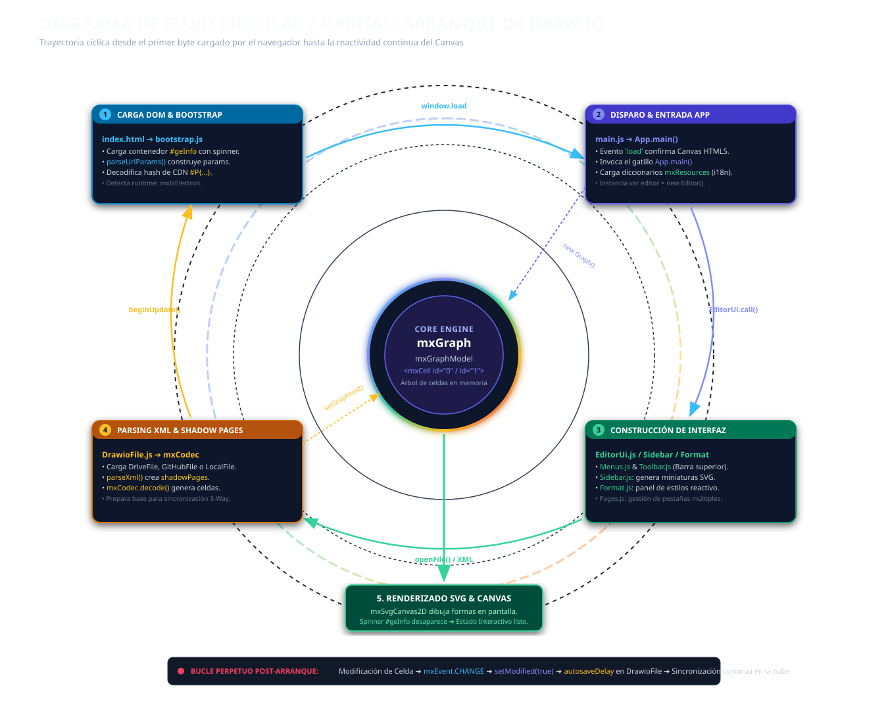

### Diagrama de Secuencia Técnico Real de Llamadas:
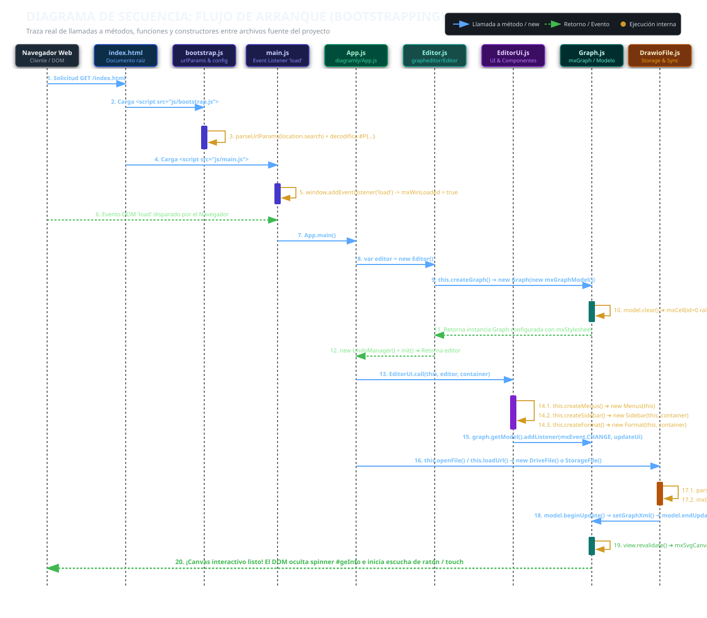

---

## 3. Relación de Herencia y Jerarquía de Clases Clave

### 3.1. Clientes de Almacenamiento (Cloud Storage Clients)

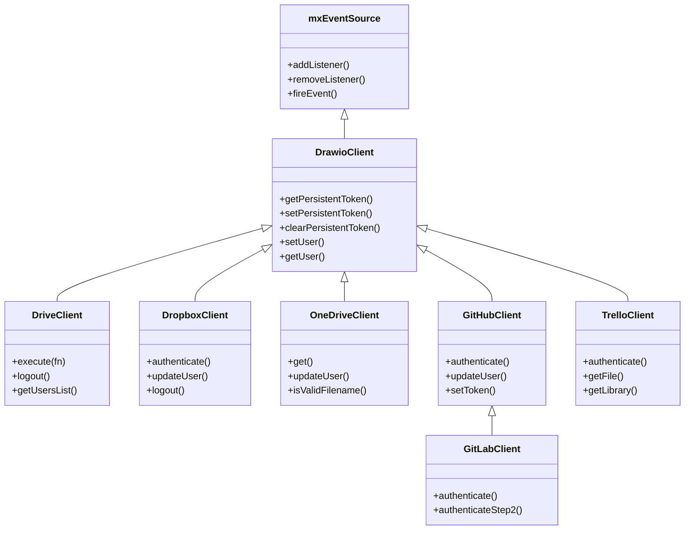

### 3.2. Representación de Archivos (DrawioFile Hierarchy)

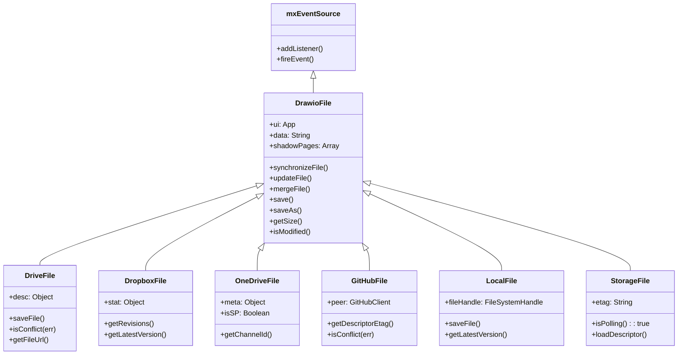

### Mapa de Doble Árbol Genealógico y Cooperación:
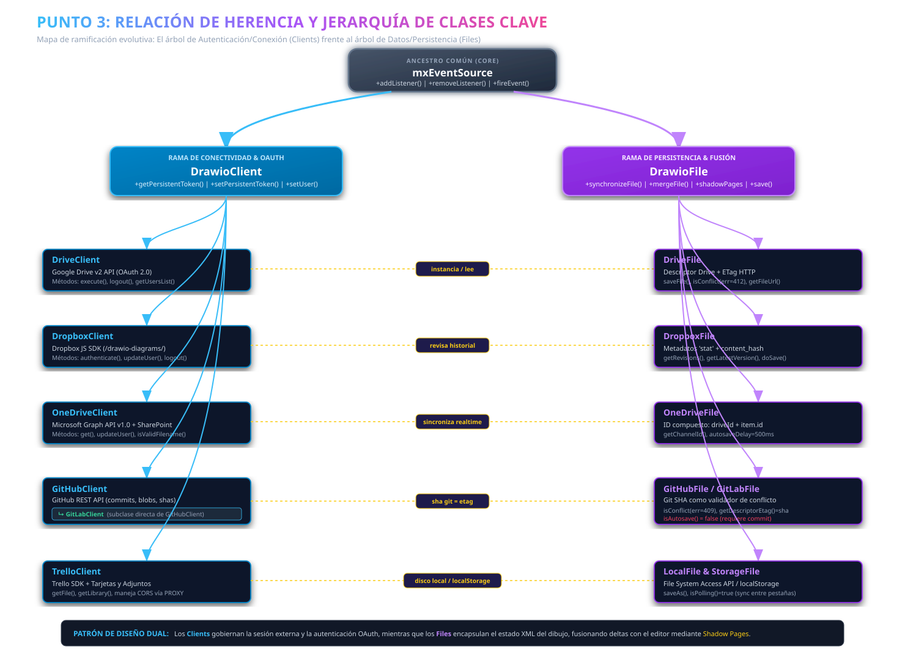

---

## 4. Funcionamiento Detallado de Cada Módulo a Nivel de Código

### 4.1. Módulo `mxGraph` (Core Diagramming Engine)
- **`mxGraph` (`mxgraph/src/view/mxGraph.js`)**: Controlador principal de la vista del grafo. Responde a eventos del ratón/touch, gestiona la selección (`mxGraphSelectionModel`), el panning, el zoom, y orquesta el renderizado de celdas (`mxCellRenderer`).
- **`mxGraphModel` (`mxgraph/src/model/mxGraphModel.js`)**: Estructura de datos subyacente (árbol de nodos y aristas). Soporta transacciones atómicas con `beginUpdate()` y `endUpdate()`, generando objetos `mxUndoableEdit`.
- **`mxCell` (`mxgraph/src/model/mxCell.js`)**: Nodo atómico que representa una figura (vértice) o conector (arista), conteniendo ID, geometría (`mxGeometry`), estilo CSS/cadena, y valor de usuario/XML.
- **`mxGraphView` (`mxgraph/src/view/mxGraphView.js`)**: Convierte las coordenadas del modelo a coordenadas de pantalla (`mxCellState`) considerando la escala y el desfase de traslación.
- **`mxCodec` / `mxGraphCodec` (`mxgraph/src/io/`)**: Serializa y deserializa el modelo del grafo desde y hacia representaciones XML estándar (`<mxGraphModel>`).

### 4.2. Módulo `grapheditor` (Componentes de UI Base)
- **`Editor.js`**: Envuelve la instancia de `mxGraph`, controla el archivo actual, el `mxUndoManager` (deshacer/rehacer) y el estado de modificación (`isModified`).
- **`EditorUi.js`**: Ensambla el layout de la pantalla creando:
  - `Menubar` (`Menus.js`) en la parte superior.
  - `Toolbar` (`Toolbar.js`) con acciones rápidas.
  - `Sidebar` (`Sidebar.js`) a la izquierda con las bibliotecas de figuras.
  - `Format` (`Format.js`) a la derecha con paneles de estilos (Relleno, Línea, Texto, Disposición).
- **`Graph.js`**: Extiende `mxGraph` agregando funciones avanzadas como exportación HTML, sanitización SVG, atajos de teclado y manipulación de texto enriquecido.

### 4.3. Módulo `diagramly` (Aplicación Web draw.io Completa)
- **`App.js`**: Punto de entrada de la aplicación completa. Gestiona diálogos de inicio ("Crear nuevo diagrama", "Abrir existente"), integración con Google Drive, Dropbox, OneDrive, GitHub, etc., y el ciclo de vida del guardado automático.
- **`DrawioFile.js`**: Implementa el algoritmo de **fusión de tres vías (3-way merge)**:
  1. Mantiene `shadowPages` (el estado exacto desde el último guardado).
  2. Al recibir cambios concurrentes o guardar, compara el estado actual contra `shadowPages` y contra el estado entrante de la nube.
  3. Resuelve conflictos automáticamente o solicita intervención al usuario.
- **`DrawioFileSync.js` & `DiffSync.js`**: Motor de sincronización en tiempo real vía WebSocket / Pusher / WebRTC colaborativo (`P2PCollab.js`). Envía únicamente parches y deltas entre clientes.
- **`vsdx/importer.js`**: Parser completo de archivos de Microsoft Visio (`.vsdx`). Descomprime el paquete OOXML ZIP, lee documentos de formas, maestros y hojas de estilo, traduciéndolos nativamente a celdas de `mxGraph`.

### Matriz de Procesamiento y Métodos a Nivel de Código:
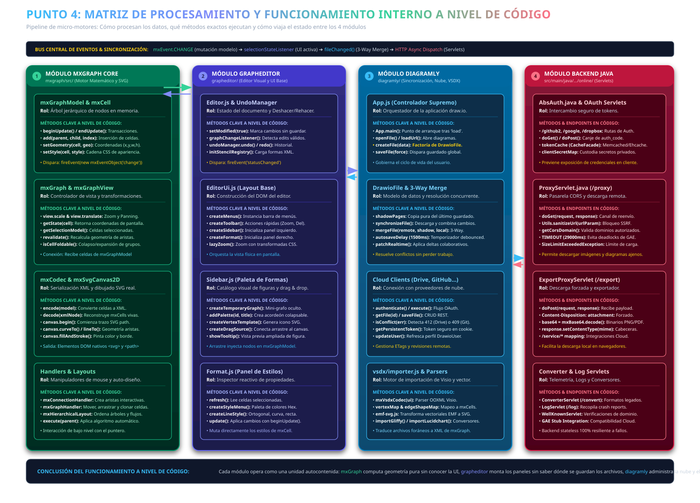

---

## 5. Módulo Backend Java (`src/main/java/com/mxgraph/online/`)

El backend de draw.io está diseñado para ser ligero, stateless y desplegable tanto en Google App Engine como en contenedores Tomcat/Jetty estándar.

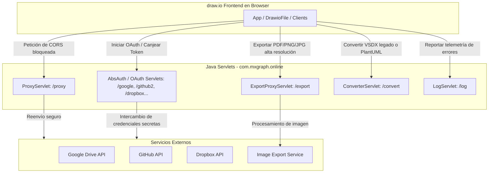

### Funciones de los servlets principales:
1. **`AbsAuth.java` / `GitHubAuthServlet.java` / `DropboxAuthServlet.java`**:
   - Gestiona el flujo OAuth 2.0 (Authorization Code Grant).
   - Oculta de manera segura los `client_secret` de las plataformas.
   - Establece cookies seguras HTTP-only (`auth-token`, `auth-state`) y cachea tokens usando `javax.cache.Cache` / Ehcache.
2. **`ProxyServlet.java` (`/proxy`)**:
   - Supera limitaciones de CORS al descargar archivos externos o recursos de iconos/imágenes.
   - Aplica validación estricta de dominios permitidos (`Utils.sanitizeUrl`).
3. **`ExportProxyServlet.java` (`/export`)**:
   - Facilita la descarga directa forzando headers `Content-Disposition: attachment` para navegadores que no soportan descargas locales vía blob.
4. **`ConverterServlet.java` (`/convert`)**:
   - Transforma formatos externos o de compresión hacia formatos entendibles por el motor JS.

### Pasarela y Enrutamiento Seguro de Servlets:
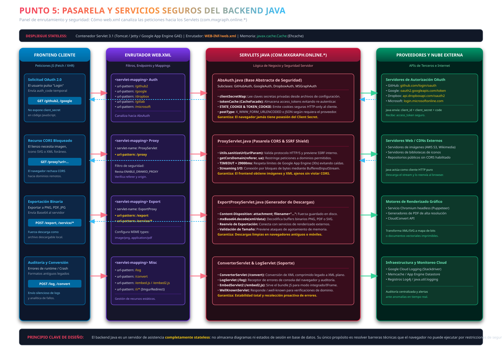

---

## 6. Flujo de Guardado y Sincronización en Tiempo Real

El siguiente diagrama detalla cómo interactúan las clases cuando un usuario edita un diagrama y el sistema guarda y sincroniza cambios concurrentes:

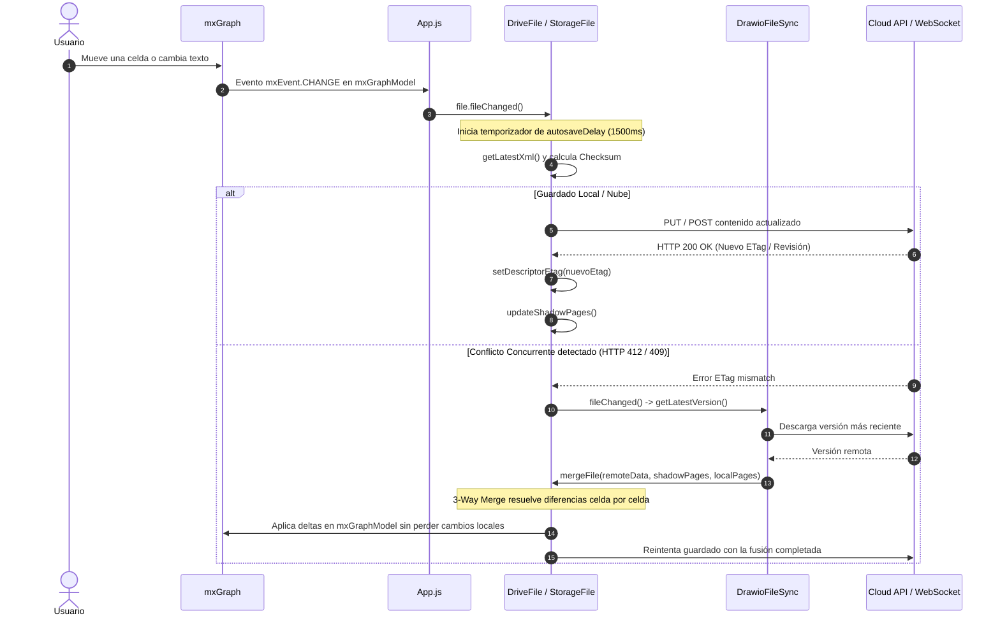

### Árbol de Decisión y Motor 3-Way Merge de Autoguardado:
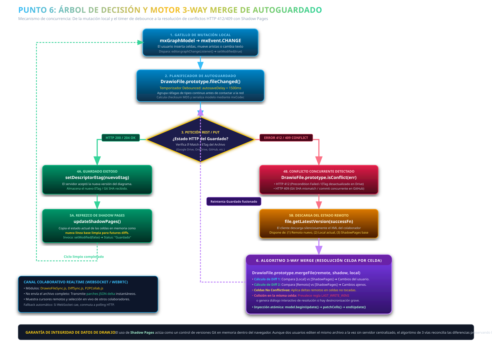

---

## 7. Mapa de Dependencias entre Archivos Principales

| Archivo / Clase | Depende de | Es llamado / utilizado por | Rol en la arquitectura |
| :--- | :--- | :--- | :--- |
| **`js/bootstrap.js`** | N/A (Entorno Browser) | `index.html` | Extrae URL params y configura el entorno base |
| **`js/main.js`** | `App.js`, `bootstrap.js` | `index.html` | Disparador final tras la carga completa del DOM |
| **`js/diagramly/App.js`** | `EditorUi.js`, `DriveClient`, `DropboxClient`, `OneDriveClient`, `GitHubClient` | `main.js` | Controlador de aplicación de nivel superior |
| **`js/diagramly/EditorUi.js`** | `grapheditor/EditorUi.js`, `Menus.js`, `Dialogs.js` | `App.js` | Extensiones de interfaz (soporte de páginas, menú de nube, plugins) |
| **`js/grapheditor/EditorUi.js`**| `Editor.js`, `Sidebar.js`, `Format.js`, `Toolbar.js` | `diagramly/EditorUi.js` | Ensamblaje físico del layout del editor |
| **`js/diagramly/DrawioFile.js`**| `mxEventSource`, `DrawioFileSync` | `DriveFile`, `GitHubFile`, `LocalFile`, etc. | Modelo de archivo, sistema de páginas fantasma (*shadow pages*) y fusión |
| **`js/diagramly/DrawioFileSync.js`**| `DiffSync.js`, `DrawioFile` | `App.js`, `DrawioFile` | Orquestación de sincronización y resolución de conflictos |
| **`js/grapheditor/Graph.js`** | `mxGraph` (core) | `Editor.js`, `Format.js`, `Sidebar.js` | Adaptación del grafo mxGraph al entorno de dibujo vectorial |
| **`mxgraph/src/view/mxGraph.js`**| `mxGraphModel`, `mxGraphView`, `mxCellRenderer` | `Graph.js` | Motor matemático y gráfico de renderizado de grafos |
| **`com/mxgraph/online/AbsAuth.java`**| `javax.servlet`, Ehcache / GAE Cache | `GitHubAuthServlet`, `GoogleAuthServlet`, etc. | Marco base para autenticación OAuth en el backend Java |
| **`com/mxgraph/online/ProxyServlet.java`**| `Utils.java` | Solicitudes `/proxy` del frontend | Pasarela HTTP para eludir restricciones de CORS |

### Topología de Red y Malla de Dependencias Cruzadas:
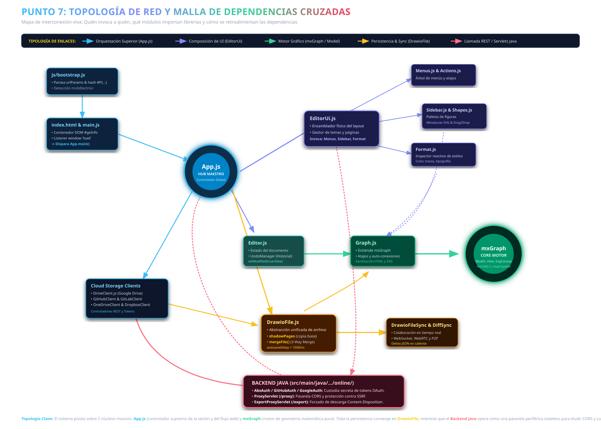

---

## 8. Resumen de Ejecución

1. **Frontend desacoplado y reactivo**: Todo el núcleo de edición y computación gráfica ocurre en el cliente mediante JavaScript y SVG nativo a través de `mxGraph`.
2. **Abstracción de almacenamiento unificada**: A través de `DrawioClient` y `DrawioFile`, cualquier proveedor de almacenamiento (Google Drive, GitHub, OneDrive, Local File System API) se comporta de forma homogénea con respecto al editor.
3. **Resistencia a desconexiones y concurrencia**: El sistema de *Shadow Pages* y el algoritmo de fusión de 3 vías garantizan que los usuarios puedan colaborar en tiempo real o trabajar sin conexión y fusionar cambios sin pérdida de datos.
4. **Backend ligero y sin estado**: Los servlets Java solo asisten en tareas que el navegador no puede realizar de forma independiente (seguridad de secretos OAuth y bypass de CORS).

### Torre de los 4 Pilares Maestros de Ingeniería:
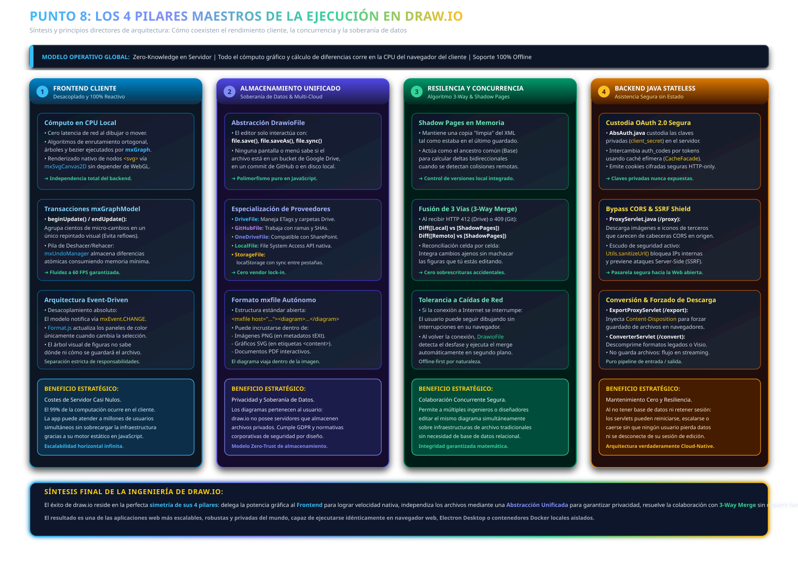

